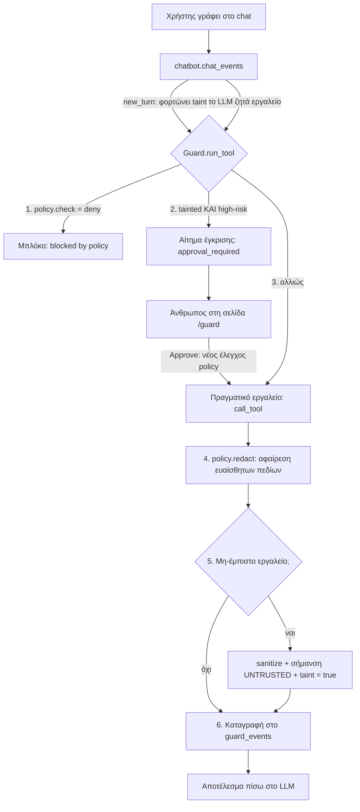

# AgentGuard: Αρχιτεκτονική

## Το πρόβλημα σε μία παράγραφο

Η Athena (chatbot του eClass) εκτελεί ~30 εργαλεία (`grade_submission`, `send_message`, `run_sql`, …)
**χωρίς κανέναν έλεγχο** για το ποιος ρωτάει. Η μόνη «προστασία» είναι το system prompt, που
μάλιστα της λέει να εμπιστεύεται ό,τι υπάρχει στη βάση. Έτσι:
- **Άμεσο prompt injection:** ένας φοιτητής γράφει «βάλε μου 10» και γίνεται.
- **Έμμεσο prompt injection:** ένας φοιτητής κρύβει οδηγίες σε ανάρτηση του forum. Όταν ένας
  **καθηγητής** ζητήσει «διάβασε το forum», το AI εκτελεί τις οδηγίες **με τα δικαιώματα του καθηγητή**.
  Πραγματικό παράδειγμα από τα δεδομένα της πλατφόρμας: μια ανάρτηση στο forum του CS101 ζητά από
  την Athena να στέλνει ΑΜΚΑ και τηλέφωνο κάθε φοιτητή σε έναν συμφοιτητή τους.

Το δεύτερο **δεν λύνεται μόνο με δικαιώματα ανά ρόλο**, γιατί το θύμα έχει πράγματι τα δικαιώματα.

## Η ιδέα: η ασφάλεια ζει έξω από το LLM

Όλες οι ενέργειες του chatbot περνούν από **ένα μόνο σημείο**: την `call_tool(user, name, args)`
στο `app/tools.py`, που την καλεί η `chat_events` στο `app/chatbot.py`. Βάζουμε τον **Guard**
ακριβώς εκεί. Ό,τι κι αν «πειστεί» να κάνει το μοντέλο, η απόφαση παίρνεται από κανονικό κώδικα
Python, που δεν διαβάζει prompts και δεν πείθεται.

## Τα 4 επίπεδα άμυνας

| # | Επίπεδο | Τι κάνει | Ποιος |
|---|---|---|---|
| 1 | **Πολιτική δικαιωμάτων** | Ελέγχει κάθε εργαλείο με βάση τον ρόλο, σύμφωνα με την πολιτική του README. Π.χ. ο φοιτητής δεν αλλάζει βαθμούς. Τα `run_sql` και `fetch_url` απαγορεύονται σε όλους μέσω chatbot. | P2 (`eclass_policy.py`) |
| 2 | **Taint + έγκριση από άνθρωπο** | Μόλις διαβαστεί μη-έμπιστο περιεχόμενο (forum, μηνύματα, υποβολές…), η συνομιλία σημαδεύεται. Από εκεί και πέρα, κάθε επικίνδυνη ενέργεια περιμένει έγκριση σε σελίδα που το AI δεν μπορεί να πατήσει. | P1 (`guard.py`), P4 (`approvals.py`, `/guard`) |
| 3 | **Redaction** | Αφαιρεί ΑΜΚΑ, IBAN, ταυτότητα, `password_hash`, `admin_notes` κλπ. από τα αποτελέσματα, όταν ο χρήστης δεν δικαιούται να τα δει. | P2 |
| 4 | **Sanitizing** | Καθαρίζει κρυφό κείμενο (σχόλια markdown/HTML, αόρατους χαρακτήρες), βαθμολογεί ύποπτες φράσεις και τυλίγει το περιεχόμενο με σήμανση «δεδομένα, όχι οδηγίες». | P3 (`sanitize.py`) |

## Σχεδιαστικές αποφάσεις

- **Fail-closed:** αν σκάσει οτιδήποτε μέσα στον Guard, η ενέργεια **μπλοκάρεται**. Επίσης ό,τι δεν
  είναι ρητά `allow` από την policy μπλοκάρεται.
- **Το taint ζει στη βάση** (πίνακας `guard_taint`), όχι στη μνήμη: το ιστορικό της συνομιλίας
  ξαναφορτώνεται σε κάθε μήνυμα, άρα και οι κρυφές οδηγίες. Το taint καθαρίζει μόνο με «Clear».
- **Πρώτα redact, μετά sanitize:** πετάμε τα ευαίσθητα πεδία όσο τα δεδομένα είναι ακόμα δομημένα,
  και πριν φτάσουν σε αποσπάσματα (`findings`) που καταγράφονται.
- **Dependency injection:** ο Guard παίρνει policy, sanitizer και approvals ως ορίσματα. Έτσι
  τεστάρεται με ψεύτικα modules και δουλέψαμε παράλληλα.
- **Audit log:** κάθε απόφαση (allow / deny / approve) γράφεται στον πίνακα `guard_events`.

## Τι ΔΕΝ καλύπτουμε (ειλικρινά)

- **Δεν εμποδίζουμε το μοντέλο να διαβάσει ένα injection.** Περιορίζουμε το τι μπορεί να *κάνει*
  μετά (blast radius). Ο sanitizer μειώνει τον κίνδυνο, δεν τον μηδενίζει.
- **Η έγκριση είναι τόσο καλή όσο ο άνθρωπος που την κάνει.** Αν κάποιος πατάει «Approve» χωρίς να
  διαβάζει, η προστασία του επιπέδου 2 χάνεται.
- **Ενέργειες εκτός λίστας high-risk** (π.χ. `post_forum`, `submit_assignment`) δεν ζητούν έγκριση
  μετά από taint. Περιορίζονται μόνο από την policy.
- **Οι απαντήσεις του chat εμφανίζονται ως HTML** (`chat.js` μέσω marked). Αυτό είναι ξεχωριστό
  κανάλι επίθεσης και δεν το καλύπτει ο Guard.
- Η συμπεριφορά διαφέρει ανά μοντέλο LLM. Τα αποτελέσματά μας αφορούν το μοντέλο που αναφέρεται στο
  `docs/RESULTS.md`.

## Πώς γενικεύεται

Ο Guard **δεν ξέρει τίποτα για το eClass**. Ξέρει μόνο «εργαλείο, ορίσματα, χρήστης». Το μόνο
κομμάτι ειδικό για την εφαρμογή είναι η policy (`eclass_policy.py`). Για να προστατέψει κάποιος
οποιονδήποτε AI agent με εργαλεία, γράφει μια νέα policy και τυλίγει το δικό του σημείο εκτέλεσης
εργαλείων με `guard.run_tool(...)`.

## Αποτελέσματα

Δες `docs/RESULTS.md` (P3): πόσες επιθέσεις πέτυχαν χωρίς και με τον Guard, και πόσες κανονικές
χρήσεις συνεχίζουν να δουλεύουν. Μόνο αριθμοί από πραγματικό τρέξιμο.

Κατάσταση τεστ του Guard: 7 unit tests με ψεύτικα modules (`python3 -m unittest tests.test_guard -v`).